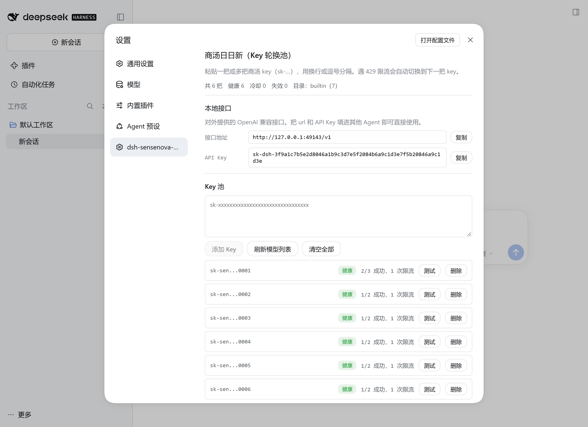
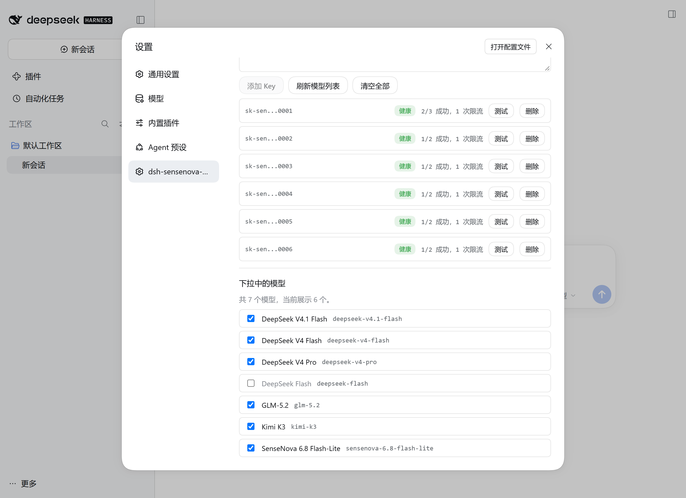
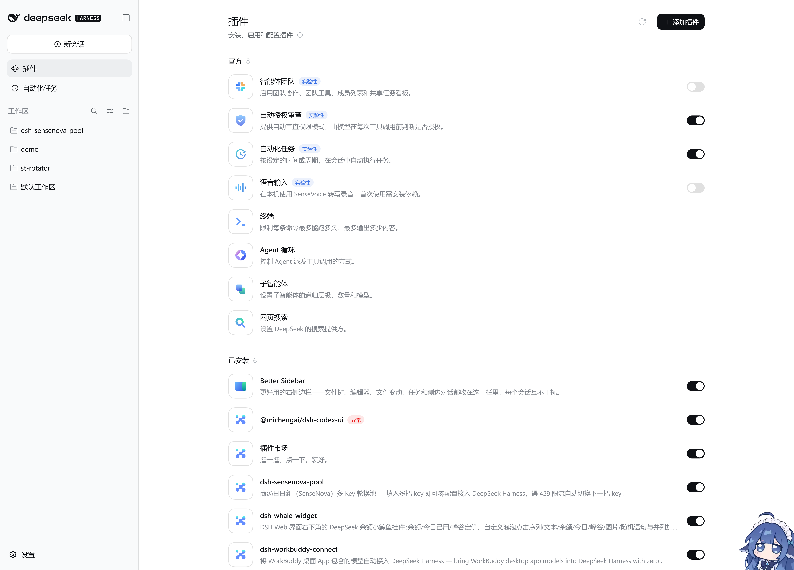

<div align="center">

# dsh-sensenova-pool

**商汤日日新（SenseNova）多 Key 轮换池 · DeepSeek Harness 插件**

在一个地方填入多把商汤 API Key，即可在 DSH 对话窗口里直接使用日日新的各种模型 —— 遇 429 限流自动切换到下一把 Key，全程无感。

[](https://www.npmjs.com/package/dsh-sensenova-pool)
[](./LICENSE)
[](https://github.com/deepseek-ai/deepseek-harness)

中文 | [English](#english)

</div>

---

> **想要一个独立运行、不依赖 DSH 的网关服务？** 请移步 **[Phoeky/st-rotator](https://github.com/Phoeky/st-rotator)**。
> 本插件是它在 DeepSeek Harness 里的内嵌版：不装 DSH、或者需要给整个局域网提供服务时，用那个项目更合适。

---

> **1.2.0**：中国站和国际站现已完全隔离，各自拥有 Key 池与模型分组。旧国际站会话升级后请重新选择「商汤日日新 · 国际站」。

## 功能

### 🔑 多 Key 轮换池

填入任意多把商汤 Key，请求在多把 Key 之间自动轮转，把每把 Key 的额度摊开使用。



- **一次粘贴多把**：换行、逗号、分号、空格分隔都可以
- **自动清洗**：识别并去除 `Bearer ` 前缀、首尾引号、重复项、明显无效的短串
- **只看得到脱敏值**：界面只显示 `sk-example...0001` 这样的掩码，明文 Key 不会出现在任何界面上
- **单把可测**：每把 Key 都能单独「测试」探活，看到真实的可用状态与延迟
- **单独删除**：任意一把失效随时移除，不影响其他 Key

### 🛡 429 限流自动切换

这是本插件的核心能力。商汤的 Key 有较低的 RPM 上限（实测现有 Key 约 3 RPM），单靠重试无法解决。本插件的做法：

- 遇 429 **立即切换到下一把 Key** 重试，用户看不到任何报错
- 每把 Key 独立冷却，按指数退避 + 随机抖动错开解冻时间
- 本地 RPM 预限流主动排队，**从源头避开**限流，而不是挨打后再退避
- 池子真的耗尽时，回报 `503 + Retry-After`（而不是 429），交由 DSH 自行退避重试
- 429 计数与冷却状态在卡片上实时可见

截图里的 `2/3 成功，1 次限流` 是真实发生的记录：这把 Key 触发过 1 次 429，被池子内部消化掉，上层没有收到过任何 429。

### 🌏 双站隔离：中国站 / 国际站（未发布）

中国站与国际站是**两个同时工作的独立实例**，不再共用一个可切换上游的池子：

| 站点 | 上游地址 | provider | 模型选择器显示 |
|---|---|---|---|
| 中国站 | `https://token.sensenova.cn/v1` | `sensenova-pool` | 商汤日日新 · 中国站 |
| 国际站 | `https://token.sensenova.ai/v1` | `sensenova-pool-intl` | 商汤日日新 · 国际站 |

设置页的「中国站 / 国际站」Tab **只切换管理视图**，不会切换请求上游，不会停用另一站，也不会清掉另一站的状态。两站可以同时对话、同时服务外部客户端。

- **Key 池独立**：Key 只加入当前管理站；删除、清空、探活均不影响另一站。
- **模型目录、隐藏模型与窗口独立**：包括同名模型，各站分别刷新目录、保存可见性及上下文窗口 / 最大输出覆盖。
- **外部接口与密钥独立**：各站有自己的本地接口地址和 API Key，外部客户端须成对使用对应站的地址与密钥。
- **冷却、失效与 RPM 状态独立**：Tab 切换不重置健康状态；默认每把 Key 的本地 RPM 中国站为 2、国际站为 3。

> ⚠️ 两站 Key **互不通用**，请分别在对应 Tab 添加。国际站 Key 发到中国站（反之亦然）可能返回 401 / 403；Tab 不会替你把已有 Key 移到另一站。

#### 从旧版升级

旧共享凭据只迁移到**旧 `endpoint` 所属站**（旧记录没有该字段时按旧配置 `endpoint` 判断，缺省中国站），另一站 Key 池和自定义模型设置为空（模型目录从该站内置基线开始），不会复制旧 Key。原有隐藏模型、窗口覆盖和外部密钥也只由所属站继承。迁移后两站分别保存独立凭据；**保留旧记录供回退**，不删除或覆盖它。

旧版国际站会话仍可能保存 `sensenova-pool`，该 provider 现在固定指向中国站。**继续旧国际站会话前，必须重新选择「商汤日日新 · 国际站」（`sensenova-pool-intl`）及对应模型**；仅切设置 Tab 不会修改会话 provider。

### 🧠 一次接入全部模型

装好插件后，模型选择器里分别出现「商汤日日新 · 中国站」和「商汤日日新 · 国际站」分组。中国站内置以下模型；国际站目录见下文常见问题：

| 模型 | 上下文 | 最大输出 | 图片输入 |
|---|---|---|---|
| `deepseek-v4.1-flash` | 1,048,576 | 65,536 | – |
| `deepseek-v4-flash` | 1,048,576 | 65,536 | – |
| `deepseek-v4-pro` | 1,048,576 | 65,536 | – |
| `deepseek-flash` | 1,048,576 | 65,536 | – |
| `glm-5.2` | 1,048,576 | 131,072 | – |
| `kimi-k3` | 1,048,576 | 65,536 | – |
| `sensenova-6.8-flash` | 1,048,576 | 65,536 | ✓ |
| `sensenova-6.8-flash-lite` | 262,144 | 65,536 | ✓ |

启动时内置一份保守目录（无需网络即可用），拿到有效 Key 后自动通过 `/v1/models` 刷新，**商汤日后上线新模型无需升级插件**。

> ⚠️ 上游 `/v1/models` 的 `context_length` **不一定可信**：它把 `sensenova-6.8-flash` 报成 262,144，
> 而实测（2026-11-17 直连上游逐级加压）**1,047,536 tokens 仍 200、约 1.05M 才 400** —— 真实窗口就是
> 1,048,576，被报小了 4 倍。对这类已实测的模型，插件用基线**覆盖**上游值；对照组 `flash-lite` 的
> 262,144 是真值（257,013 通过、275K 档 400），保持不动。其余模型仍以上游为准，不影响「新模型无需改代码」。

思考等级同样支持，且**档位按模型自动适配**：`glm-5.3` 只认 `low / high / max`，`glm-5.2` 七档全收，缺档时自动就近归位而不是撞 400（见下文「思考档位按模型映射」）。

### ⚙️ 零配置

Key 存在 DSH 的凭据库里，不写进任何配置文件。填入即生效，无需重启 DSH、无需改 YAML。

### 🧩 在 DSH 设置里管理

设置侧栏新增 `dsh-sensenova-pool` 分区，Key 池、对外接口、模型可见性都在这一页。插件页里的卡片同样可以打开。

每个模型的**上下文窗口**与**最大输出**都能改：点模型行右侧的「设置」，在展开的面板里填写后点「保存」才生效
（`取消` 丢弃草稿，`恢复默认` 清掉覆盖）。输入框接受 `1M` / `128K` 这种简写，也接受精确数字。
上游对个别模型会报小窗口，基线只覆盖了我们实测过的那些；其余的可以按你自己的实测或套餐情况修正。

### 🔌 提供对外的 OpenAI 兼容接口

插件为两站分别在 127.0.0.1 上提供独立 OpenAI 兼容服务。当前 Tab 显示该站接口地址和 API Key，复制后填进其他 Agent 或客户端即可使用；请求只共用该站的 Key 池，遇到限流同样自动换 Key。以下地址仅为中国站示例，请以各 Tab 实际显示为准。

```bash
curl http://127.0.0.1:51234/v1/chat/completions \
  -H "Authorization: Bearer sk-dsh-…" \
  -H "Content-Type: application/json" \
  -d '{"model":"glm-5.2","messages":[{"role":"user","content":"ping"}]}'
```

- API Key 存在凭据库里，重启后不变
- 端口由系统在启动时分配，设置页显示当前值

### 🎛 管理可选择模型

设置页列出目录里的全部模型。取消勾选的模型不再注册给 provider，也就不会出现在模型选择器里，这个选择重启后保留。套餐里不含某些模型时，可以在这里把它们关掉。



---

## 安装

### 方式一：npm（推荐）

```bash
npm install dsh-sensenova-pool
```

或使用 pnpm：

```bash
pnpm add dsh-sensenova-pool
```

安装后，把 `dsh-sensenova-pool` 加入 profile `package.json` 的 `dsh.profile.bundles`：

```json
{
  "dsh": {
    "profile": {
      "bundles": [
        "dsh-sensenova-pool"
      ]
    }
  }
}
```

### 方式二：本地开发

```bash
git clone https://github.com/Phoeky/dsh-sensenova-pool.git
cd dsh-sensenova-pool
npm install
npm run build

# 链接到你的 profile
pnpm --dir "$DSH_PROFILE_DIR" add "link:$PWD"
```

同样需要把 `dsh-sensenova-pool` 加进 `dsh.profile.bundles`。

### 重启 DSH

改完 `package.json` 后**重启 DeepSeek Harness**。确认安装成功：插件页的「已安装」列表里会出现本插件。



---

## 使用

### 1. 选择管理站并填入 Key

打开 **设置 → dsh-sensenova-pool**（或插件页里本插件的卡片），先选中国站或国际站 Tab，再粘贴该站申请的一把或多把商汤 Key：

```
sk-aaaaaaaaaaaaaaaaaaaaaaaaaaaaaa
sk-bbbbbbbbbbbbbbbbbbbbbbbbbbbbbb
sk-cccccccccccccccccccccccccccccc
```

点「**添加 Key**」。支持多种分隔方式，重复和无效项会被自动过滤。

### 2. 确认管理视图与上游地址

当前 Tab 显示该站的实际上游地址。Tab 只决定你正在管理哪一站；两站仍同时工作。**Key 只在自己申请的那个站有效**，请不要将它加入另一站。

### 3. 选择模型

新建会话，在模型选择器里选「**商汤日日新 · 中国站**」或「**商汤日日新 · 国际站**」下的对应模型，然后正常对话即可。会话 provider 决定请求所属站，与设置页当前 Tab 无关。旧国际站会话须重新选择国际站 provider。

### 4. 需要时调整

| 按钮 | 作用 |
|---|---|
| **测试** | 对单把 Key 发一次极小请求，立刻看到是否可用与延迟 |
| **删除** | 移除单把 Key |
| **清空全部** | 移除所有 Key |
| **刷新模型列表** | 主动从商汤 `/v1/models` 拉取最新模型目录 |
| **复制**（接口区） | 复制接口地址 / 对外 API Key |
| **模型勾选框** | 决定该模型是否出现在模型选择器里 |

### 5. 接入其他服务

设置页当前站的「本地接口」区给出两样东西；另一站有独立地址和密钥，不可混用：

| 字段 | 示例 | 说明 |
|---|---|---|
| 接口地址 | `http://127.0.0.1:51234/v1` | OpenAI 兼容，`/chat/completions`、`/models` 都支持，流式/非流式都行 |
| API Key | `sk-dsh-…` | 填进 `Authorization: Bearer` 即可 |

任何 OpenAI 客户端都可以直接用它，例如：

```python
from openai import OpenAI

client = OpenAI(base_url="http://127.0.0.1:51234/v1", api_key="sk-dsh-…")
print(client.chat.completions.create(
    model="glm-5.2",
    messages=[{"role": "user", "content": "你好"}],
).choices[0].message.content)
```

这个 Key 只被本地 shim 校验，**不会发给商汤**；真实的商汤 Key 始终只存在于插件内部。

---

## 配置项（可选）

绝大多数情况无需改动。如需微调，在 profile 的 `cordis.patch.yml` 里加入：

```yaml
- id: llm-sensenova-pool
  name: dsh-sensenova-pool
  config:
    endpoint: cn         # 旧配置兼容：旧记录归属及自定义 baseUrl 所属站；不再切换运行实例
    rpmLimit: 2          # 每把 Key 的本地 RPM 预限流上限；0 = 关闭，-1（默认）= 按端点取值
    maxAttempts: 6       # 单个请求最多尝试几把 Key
    maxConcurrency: 1    # 每把 Key 的并发上限；1 = 串行（推荐）
    acquireTimeoutMs: 180000
    requestTimeoutMs: 60000
    # baseUrl: https://token.sensenova.cn/v1   # 仅覆盖 endpoint 指定的站；另一站仍用官方地址
```

`endpoint` 保留用于旧凭据归属兼容（旧记录自身的 `endpoint` 字段优先）以及指定自定义 `baseUrl` 所属站，**不控制两站启停或 Tab**。两站始终各自使用固定上游；`baseUrl` 只覆盖配置 `endpoint` 所属站，另一站仍走官方地址，避免错误复用地址而泄漏 Key。`rpmLimit` 留默认值时按站取值（中国站 2、国际站 3），显式写数字则两站使用同一上限数值，但各自的计数与冷却独立。

`rpmLimit` 的中国站默认值 2 基于实测（真实上限约 3 RPM）。**调大它不会提高吞吐，只会更容易被限流** —— 想提高吞吐应该增加 Key，而不是加压。

**两个站的 Key 能混着用吗？** 不能。Key 只在发卡站有效。请在各站 Tab 分别添加；切换 Tab 不搬移、不删除 Key，也不改变另一站的请求。

---

## 常见问题

**国际站 Key 显示「已失效」？**

先确认 Key 是否在国际站申请、是否添加到了国际站 Tab。两站 Key 互不通用；Tab 切换不会清除失效或冷却标记。若误加到另一站，请移除后在正确站添加；归属正确仍返回 401 / 403 时，再检查 Key 或套餐权限。

**国际站里怎么没有 `deepseek-v4-flash` / `glm-5.2`？**

这些模型只在中国站提供。国际站目前有 5 个模型，且**全部列出、不做事先筛选**：

| 模型 | 输出 | 对话实测（2026-11-19） |
|---|---|---|
| `sensenova-6.8-flash` | 文本 | ✅ 流式 / 非流式 / 图片输入 / 七档思考强度 |
| `sensenova-6.8-flash-lite` | 文本 | ✅ 同上 |
| `sensenova-6.7-flash-lite` | 文本 | ⚠️ 本 key 返回 404 `model is not found` |
| `sensenova-u1-fast` | 图片 | ⚠️ 生图模型，对话接口 404 |
| `sensenova-u1.5-lite` | 图片 | ⚠️ 生图模型，对话接口 404 |

⚠️ 的那三个仍然展示：404 可能是套餐/灰度差异，隐藏会让有权限的人也选不到。选中后上游
会如实报 404 —— 不想要的话在设置页取消勾选即可，可见性会持久化。

**模型选择器里没有「商汤日日新」分组？**

确认 `dsh.profile.bundles` 里有 `dsh-sensenova-pool`，然后**重启 DSH**。如果分组在但某个模型不见了，去设置页看看是不是被自己勾掉了。

**管理卡片在哪？**

两个入口都在：**设置 → dsh-sensenova-pool**（推荐），以及插件页里本插件的详情卡片。旧版 DSH 若没有设置分区，会退回只显示插件页卡片。

**一直失败怎么办？**

在卡片上点某把 Key 的「测试」看真实原因。`403 model is not available in the current token plan` 表示该模型不在这个 Key 的套餐里 —— 换模型，而不是换 Key。

**DSH 弹「The application could not start or stopped unexpectedly」，完全起不来？**

先看崩溃日志里的失败插件名。如果 `Failed plugins` 指向 `credentials`，且错误是
`record "dsh-sensenova-pool/keys" ... has unknown field "payload"`，说明凭据库里那条记录
的标签写错了 —— DSH 的凭据库对记录做白名单校验，`api-key` 只认 `kind`/`key`/`env`，
`grant` 只认 `kind`/`payload`，**一条记录不合规就会让 `credentials` 插件激活失败，进而
中止整个应用启动**（0.1.1 及更早版本存在这个写入 bug，已修复）。

手工修复：编辑 `$DSH_HOME/.credentials.yaml`，把该记录的 `kind: api-key` 改成
`kind: grant`（`payload.keys` 里的 Key 原样保留），然后重启 DSH。

```yaml
records:
  dsh-sensenova-pool/keys:
    kind: grant          # ← 必须是 grant；api-key 不接受 payload
    payload:
      keys:
        - sk-…
```

崩溃日志位置：Windows 下为 `%APPDATA%\@deepseek-ai\dsh-desktop\logs\crash-*-host.log`。

**重启电脑后 Key 池空了（「忘记 Key」）？**

0.1.2 及更早版本存在一个**启动竞态**：插件启动时只读一次凭据库，而 DSH 的凭据快照
是异步读盘填充的，冷启动磁盘慢时就会读到空快照，于是池子变成 0 把 —— 且此后没有任何
补载机制，只能重新填 Key。**0.1.3 已修复**（改为等凭据服务真正就绪后再装载）。

如果你还在旧版本上遇到，升级即可，不需要重新填 Key（Key 一直好好地在
`$DSH_HOME/.credentials.yaml` 里）。临时办法是在插件卡片上点一次「刷新/重载」。

**报 `400 inference request is invalid` / `400 invalid arguments`？**

这是 **商汤网关的 schema 校验**比 OpenAI 官方严导致的，不是 Key 无效，也不是限流——
换 Key 完全没用。Agent（DSH 的 pi-ai 层）会按 OpenAI 规范发出一些「官方接受、商汤不认」
的写法：

| 请求体写法 | 商汤 `deepseek-v4-flash` | 说明 |
|---|---|---|
| `{"role":"developer","content":"…"}` | ❌ 400 | OpenAI 新规范里替代 `system` 的角色，商汤只认 `system` |
| `{"role":"assistant","content":null}`（无 `tool_calls`） | ❌ 400 | 表示「这一轮只有工具调用」的常规写法 |
| `{"role":"system","content":null}` / `{"role":"tool","content":null}` | ❌ 400 | 工具结果为空时很常见 |
| `tool_calls[*].function.arguments` 传**对象** | ❌ 400 `invalid arguments` | 必须是 JSON 字符串 |
| `content` 传数字（`123`） | ❌ 400 `invalid arguments` | 必须是字符串或数组 |
| `temperature` 等传字符串（`"0.7"`） | ❌ 400 `invalid arguments` | 必须是数字 |
| `logprobs` / `top_logprobs` / `metadata` | ❌ 400 | 商汤不支持这些字段 |
| `reasoning_effort` 传 `off` | ❌ 400 `field ReasoningEffort invalid` | DSH 的 `off` 商汤拼作 `none` |
| `reasoning_effort` 传**该模型不认的档位**（如 `glm-5.3` 收到 `xhigh`） | ❌ 400 `field ReasoningEffort invalid` | 合法词表**按模型**判定，见下方「思考档位按模型映射」 |
| 给 `kimi-k3` 传任何非 `1` 的 `temperature` | ❌ 400 `field Temperature invalid, only 1 is allowed` | 该模型没有可调随机性；shim 会在转发前把它归一到 `1` |

**0.2.1 已修复**：shim 在转发前会把这些写法**语义等价**地规范成商汤接受的形式
（`developer`→`system`、`null`/缺失的 content→`""`、`arguments` 对象→JSON 字符串、
数值字符串→数字、`off`→`none`、摘掉不支持字段），
**你不需要改任何配置**。带 `tool_calls` 的 `content: null` 会**保持原样**（商汤接受，动它反而有风险）。

> 特别说明：`max` 与 `minimal` **本来就是合法档位**（上游报错原文列全了它们），
> 所以不会被改动或降级 —— 否则会悄悄改掉你要求的推理强度。

刻意不代改的三类（改了只会把错误往后推）：`user.content` 为空、数值**越界**
（如 `temperature: 3`）、未知 role。

> 💡 如果升级后仍报 400，说明是清洗层还没覆盖的新写法。此时把
> `debugRequestOn400` 打开，插件的 400 日志里会**直接打出实际发出的请求体**，
> 一眼就能定位是哪个字段——不用再猜。相关讨论见 [issue #2](https://github.com/Phoeky/dsh-sensenova-pool/issues/2)。

### 思考档位按模型映射

[issue #3](https://github.com/Phoeky/dsh-sensenova-pool/issues/3) 实测发现：上游的合法
`reasoning_effort` 集合是**按模型**判定的，不是全局一张表。`glm-5.3` 只认
`low / high / max`，收到 `xhigh` 就是 400；而 `glm-5.2`、`deepseek-v4-flash`
七档全收。单一映射表无论怎么调都会踩到某一头。

**0.2.2 起**改为每个模型维护一张实测词表：

| 模型 | 实测接受的档位 |
|---|---|
| `glm-5.3` | `low` / `high` / `max` |
| `glm-5.2`、`deepseek-v4-flash`、`sensenova-6.8-flash`、`sensenova-6.8-flash-lite` | 七档全收 |
| `kimi-k3` | 七档，`max` 未确认 → 不发 |
| `deepseek-flash` | 七档，`xhigh` 未确认 → 不发 |
| 其他 / 新上架模型 | 保守表 `low` / `high`（全员交集，永不 400） |

模型选择器里**只显示这张表里真实存在的档位**：`glm-5.3` 的思考档下拉就是
`Low / High / Max`（+`Default`）—— 不会出现「选了 `Xhigh`、实际发 `max`」这种
看着能用、发出去却换了值的档位。

shim 侧另有一层兜底：万一别的客户端（或旧配置）发来该模型不认的值，转发前会
**就近改合法** —— `xhigh` / `max` 这类饱和档由模型最强档承接（不降级，`glm-5.3` 的
`xhigh → max`），其余档向下取（`medium → low`、`off → low`），宁可省 token 也不
悄悄抬高成本。

未实测的模型（新上架、或还没测过的）只显示保守表 `low` / `high` —— 七档里只有这两档
是全员交集。写漏顶多降一档，写多会让整条链路每次都 400。新模型上架后，把它的词表
补进 `MODEL_REASONING_EFFORTS`（`src/catalog.ts`）即可。

**Key 会泄漏吗？**

不会。界面只显示掩码；明文只存在 DSH 凭据库（`$DSH_HOME/.credentials.yaml`）中，不会写入任何配置文件，也不会出现在日志里。

**设置页里的 API Key 和我的商汤 Key 是一回事吗？**

不是。设置页「本地接口」区显示的 `sk-dsh-…` 是**本地回环服务自己的**校验密钥，只用于让别的本地程序访问 `127.0.0.1` 上的 shim；它不会被转发给商汤，和你的商汤 Key 没有任何关系。真正的商汤 Key 仍然只以掩码形式出现在列表里。

**别的机器能连这个接口吗？**

不能，也不需要。shim 只绑定 `127.0.0.1`，这是刻意的：它背后是你的额度。要在多台机器/整个局域网共享，请用 [Phoeky/st-rotator](https://github.com/Phoeky/st-rotator) 这类独立网关。

---

## 环境要求

- DeepSeek Harness `0.2.0-rc.2` 或更高
- Node.js `^22.19.0 || >=24.0.0`

---

## 致谢

本插件在设计与实现上参考了以下开源项目，特此致谢：

- **[corrinehu/dsh-workbuddy-connect](https://github.com/corrinehu/dsh-workbuddy-connect)** —— 将第三方模型接入 DSH 的插件范式。本插件的 provider 注册方式与浏览器卡片结构参考了该项目。
- **[Phoeky/st-rotator](https://github.com/Phoeky/st-rotator)** —— 商汤 Key 轮换网关。本插件的轮换调度、冷却退避与本地预限流策略参考了该项目。

特别感谢以下朋友反馈问题、提供实测数据，其中好几处结论直接改变了实现方向：

- **@Drhusku** —— [issue #1](https://github.com/Phoeky/dsh-sensenova-pool/issues/1) 启动期凭据竞态、[issue #4](https://github.com/Phoeky/dsh-sensenova-pool/issues/4) 上游把 `sensenova-6.8-flash` 的 1M 窗口谎报成 262144（还附了逐级加压的实测表，让"该不该覆盖上游"这件事有据可依）。
- **@Sumtenm** —— [issue #3](https://github.com/Phoeky/dsh-sensenova-pool/issues/3) 逐个模型逐个档位实测出 `reasoning_effort` 的词表差异，直接促成了"按模型维护词表"这一版重构。
- **@Mahiro-FT** —— [issue #2](https://github.com/Phoeky/dsh-sensenova-pool/issues/2) 最先报出 400，并配合确认了复现路径。

---

## 许可

[MIT](./LICENSE)

---

<a id="english"></a>

## English

> **Looking for a standalone gateway that runs without DSH?** See **[Phoeky/st-rotator](https://github.com/Phoeky/st-rotator)** — this plugin is its in-harness edition. Use that project if you don't run DeepSeek Harness or need to serve a whole LAN.

**A multi-key rotation pool for SenseNova (商汤日日新) as a DeepSeek Harness plugin.**

Paste one or more SenseNova API keys in one place and use every SenseNova model directly in the DSH chat window — rate-limited keys (HTTP 429) are switched out automatically and transparently.

### Features

- **Managed in DSH Settings** — a settings section named `dsh-sensenova-pool` holds the key pool, the local endpoint and the model list
- **An OpenAI-compatible endpoint** — the settings page shows the base URL, port and an API key to copy into another agent or client; requests share the same pool and the same 429 handling
- **Choose which models appear** — uncheck a model and it stops being registered with the provider; the choice survives restarts
- **Multi-key pool** — paste any number of keys at once (newline / comma / semicolon separated); prefixes, quotes, duplicates and junk are cleaned automatically
- **Automatic 429 failover** — on rate limiting the pool immediately retries with the next key; each key cools down independently with exponential backoff and jitter, plus local RPM pre-throttling to avoid 429s in the first place
- **Never leaks a 429 upward** — when every key is exhausted the plugin reports `503 + Retry-After` so DSH backs off on its own
- **All models, zero config** — a built-in catalogue works offline and refreshes from `/v1/models` once a valid key is present, so new models need no plugin upgrade
- **Keys are masked** — only `sk-example...0001` style masks are ever displayed
- **双站隔离（未发布）** — 中国站 / 国际站 Tab 只切管理视图，两站同时工作；provider 分别为 `sensenova-pool` / `sensenova-pool-intl`，显示「商汤日日新 · 中国站 / 国际站」。各站 Key 池、模型目录、隐藏模型、窗口覆盖、本地接口 / 密钥与冷却 / RPM 状态完全独立。旧凭据仅迁移到旧 `endpoint` 所属站，另一站为空，旧记录保留回退；旧国际站会话须重新选择国际站 provider。

### Install

```bash
npm install dsh-sensenova-pool
```

Add `"dsh-sensenova-pool"` to `dsh.profile.bundles` in your profile `package.json`, then restart DeepSeek Harness.

### Usage

Open **Settings → dsh-sensenova-pool** (or the plugin card on the Plugins page), pick your endpoint (China site / international site — a key only works on the site that issued it), paste your keys, click **Add keys**, then pick any model under the "商汤日日新（Key 轮换池）" group in the model picker. The same page shows the local endpoint (base URL, port, API key) and lets you hide models from the picker.

### Troubleshooting

**The key pool is empty after rebooting the machine ("it forgot my keys")?**

Versions 0.1.2 and earlier had a startup race: the plugin read the credential store once at startup, while DSH fills that store from disk asynchronously. On a slow cold boot the plugin read an empty snapshot, so the pool came up with zero keys — and nothing ever re-loaded it, forcing you to re-enter them. **Fixed in 0.1.3** (the plugin now waits until the credentials service is genuinely ready before loading).

Upgrade and your keys will be picked up again; they were never lost (they live in `$DSH_HOME/.credentials.yaml`). On an older version, clicking reload on the plugin card recovers them for the session.

### Acknowledgements

- [corrinehu/dsh-workbuddy-connect](https://github.com/corrinehu/dsh-workbuddy-connect) — the plugin pattern for bringing third-party models into DSH
- [Phoeky/st-rotator](https://github.com/Phoeky/st-rotator) — the SenseNova key-rotation gateway this plugin's rotation strategy derives from

Thanks to everyone who reported issues and shared measured data — several conclusions came straight from these reports:

- **@Drhusku** — [issue #1](https://github.com/Phoeky/dsh-sensenova-pool/issues/1) credential race at startup; [issue #4](https://github.com/Phoeky/dsh-sensenova-pool/issues/4) upstream under-reporting `sensenova-6.8-flash`'s 1M window as 262144, with a full pressure-test table.
- **@Sumtenm** — [issue #3](https://github.com/Phoeky/dsh-sensenova-pool/issues/3) per-model `reasoning_effort` vocabulary measurements that drove the per-model table rewrite.
- **@Mahiro-FT** — [issue #2](https://github.com/Phoeky/dsh-sensenova-pool/issues/2) the first 400 report, plus reproduction follow-up.

### License

[MIT](./LICENSE)
